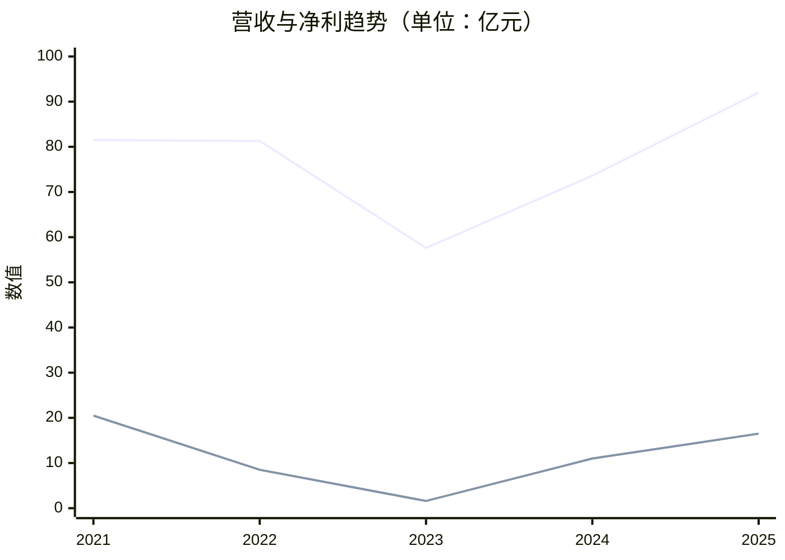
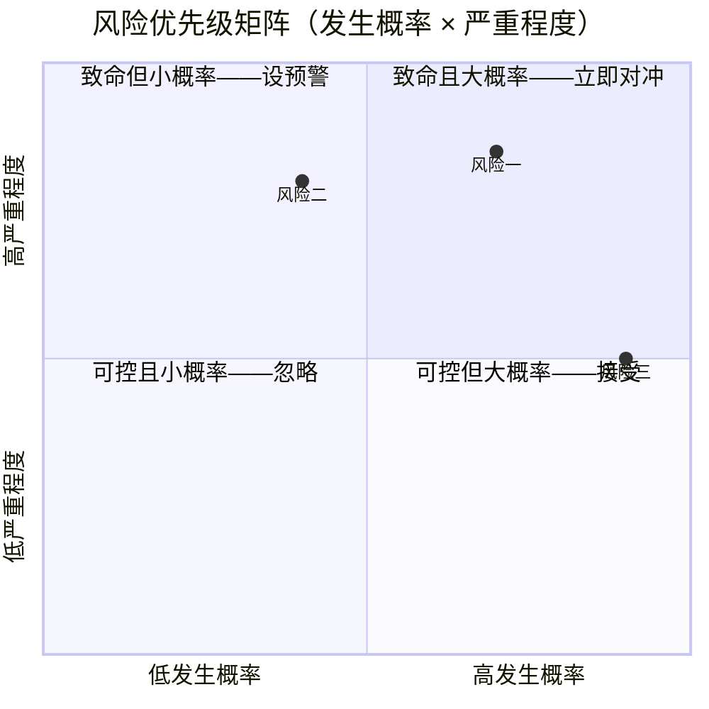

# 公司研究笔记模板

用于用户明确要求生成完整公司拆解笔记时。根据公司类型、研究问题和证据可得性选择适用模块；窄问题无需套用完整模板。模板中的数值与示例仅说明格式，不得作为研究事实。

---
title: "[公司名] 公司拆解"
created: YYYY-MM-DD HH-mm
type: 公司研究
status: draft
skill: company-research v1.0
tags:
  - 商业分析
  - 公司研究
  - [行业标签]
---

> 📌 **按任务选择模板模块**：窄问题只保留相关内容；完整拆解再使用适用的行业模块。此模板是按需参考，不是每次研究的必填清单。
>
> **行业适用性**：
> - 【通用】关键财务数据、客户拆分、阶段小结、风险清单底层逻辑——所有行业
> - 【科技/制造类必备】技术演进路径与公司卡位——有技术迭代的行业（半导体、光模块、汽车等）
> - 【高端制造可选】供应链双向依赖——精密设备/核心零部件公司（反向追问，不强制）
> - 【A 股/上市可选】资金面与 ETF 拥挤度——有公开交易数据的公司

## 一句话定性 【解释层】

[公司名] 是一家______公司。

---

<!-- 以下为完整拆解模板。按任务选择相关部分；不适用模块可省略并说明范围。 -->

## 一、这家公司是谁？【事实层 + 解释层】

### 类比 【解释层】

> [一到两句精炼类比，类比本身为解释性内容，非事实陈述]

### 业务版图 【事实层】

| 收入线 | 模式 | 占比 | 增速 | 数据口径 | 证据等级 | 备注 |
|--------|------|:----:|:----:|---------|:-------:|------|
| | | | | | | |

> 数据口径填写规范：**A 级-公司披露** / **B 级-行业权威** / **C 级-券商估算** / **D 级-产业链消息** / **E 级-AI 推理**。若最新季报未披露分项数据，在表格下方注释说明"分项数据基于 XX 趋势推演，存在不确定性"。

### 关键财务数据（交叉验证） 【事实层】

| 指标 | 时间段 | 数值 | 同比 | 证据等级 |
|------|:-----:|:----:|:----:|:-------:|
| 营业收入 | | | | |
| 归母净利润 | | | | |
| 毛利率 / 净利率 | | | | |
| 季度营收环比趋势 | 最近 4 个季度 | Q1→Q2→Q3→Q4（如公司未披露季度数据则标注"暂缺"或使用半年报推算） | — | A |

> **⚠️ 数据来源与冲突**：标注原始出处、期间、定义/口径与采集时间。判断所需时做独立交叉验证；多篇转述同一原始披露不构成独立来源。若同期间同口径的数值差异超过 10%，必须暴露，不得平滑：
> - 来源 A（XX 机构 / 口径）：数值 X
> - 来源 B（YY 机构 / 口径）：数值 Y
> - 差异可能原因：[forward vs TTM / 口径不同 / 预测版本 / 其他]
> - 采纳：[说明以哪个为准及原因，或标注"暂无法裁定"]

> **财务细节注释**：如有异常信号（存货激增/经营现金流大幅波动/应收账款异常等），在此解释产业层面的可能原因，区分"市场误读"与"真实风险"。

#### 周期曲线 【事实层】（条件触发：峰谷差 >30% 的周期型公司）

当营收/净利呈现明显周期波动时，用折线图呈现"波动体感"——这是表格无法替代的。**平稳增长型公司跳过此图。**

> 数据替换为公司实际值；净利若为负，y-axis 下限设为负数。仅 A/B 级数据入图，C 级以下不画。

### 反直觉发现 【事实层 + 解释层】

[基于已验证数据提取的意外发现，每个发现标注数据来源，用编号列表呈现]

### 阶段小结 【解释层】

> **阶段小结**：搞了半天，它其实是一家**\_\_\_\_**公司。

---

## 二、凭什么活着？【解释层 + 推测层】

### 护城河分析

**真护城河**（对手短期打不掉）：
1. **[]** —— 【证据等级：X 级，依据说明】
2. **[]** —— 【证据等级：X 级，依据说明】

**伪护城河**（看起来很厉害但容易被追上）：
1. **[]** —— 【证据等级：X 级，依据说明】

#### 技术护城河动态评估：技术演进路径 【解释层 + 推测层】

> **要求**：覆盖至少三层——当前主力 → 短期下一代 → 远期路线 + 威胁方向。每层标注时间节点和证据等级。
> **禁止**：只写趋势不写风险，或只写到下一代就结束。
> **纪律**：每个 timeline claim（如"2028 年前后商用"）须标注依据——是公司公告、行业权威预测、券商估算、还是 AI 推演。不得把行业推演讲成确定事实。
>
> 例如：
> - **当前主力**：800G 可插拔（已量产）→ 1.6T 放量中（2026E，全球市占~70%）【证据等级：C 级】
> - **短期下一代**：硅光方案渗透率超 50%（降本 15-20%）；3.2T 已进入研发送样阶段（预计 2027-2028 年起量）【证据等级：C 级】
> - **远期路线**：6.4T NPO / 12.8T XPO 在研（量产时间表未公开披露）【证据等级：D 级】
> - **威胁方向**：CPO（光电共封装）——如 2028 年前后大规模商用（注：此为行业推演，厂商未公布具体量产时间线），可插拔光模块价值链可能被重构【证据等级：D 级】

### 阶段小结 【解释层】

> **阶段小结**：它之所以还没被打死，最核心的原因是**\_\_\_\_**。

---

## 三、会不会死？【解释层 + 推测层】

### 风险清单

| 风险 | 严重程度 | 可控性 | 时间维度 | 市场低估程度 | 证据等级 |
|------|:-------:|:------:|:--------:|:----------:|:-------:|
| | 🔴/🟡/🟢 | 可控/致命 | 短期/中期/长期 | 严重/部分/合理 | |
| 【可选】资金面风险（ETF 超配/机构拥挤） | 🟡 中等 | 不可控 | 短期 | 部分低估 | |

#### 风险优先级矩阵 【推测层】（条件触发：风险清单 ≥3 条）

把风险清单投射到"概率 × 严重程度"四象限，一眼看出最该盯哪个——表格列得清但看不出优先级。

> 坐标 [概率, 严重]，均归一化到 0-1。仅对 ≥3 条风险生成；风险少于 3 条跳过此图。

### 空头视角 【推测层】

> [!warning] 空头视角
> [反方辩手的核心论点]

> **可选追加**：如属 A 股/上市热门标的，可检查机构持仓结构是否存在"ETF 化"特征（被动资金占比过高），这种结构在 AI 主题退潮时可能触发正反馈踩踏。资金来源：季报股东数据。

### 三个风险排序 【推测层】

1. **风险一**（最具破坏性）——
2. **风险二**（最结构性）——
3. **风险三**（最确定）——

---

## 四、我的判断 【推测层】

> 以下属于前瞻性推演，不代表事实确认。

- **最打动我的一个点**：
- **最让我担心的一个点**：
- **短期看**（1-2 年）______，**中期看**（2-3 年）______，**长期看**（3-5 年）______
- **关键假设**（这个判断建立在什么前提上）：
  1.
  2.
  3.
- **最终拷问**：如果\_\_\_\_\_\_，你怎么办？

---

### 什么情况会推翻这个判断？ 【推测层】

> [!warning] 推翻判断的触发条件
> 以下情况若发生，当前投资逻辑可能失效：
> 1.
> 2.
> 3.

---

## 研究可信度摘要

| 可信度 | 内容 | 证据等级 |
|:-----:|------|:--------:|
| 🟢 高 | 公司财务数据、行业排名、客户集中度 | A 级 |
| 🟡 中 | 增长预测、技术路线判断、护城河评估 | B-C 级 |
| 🔴 低 | 市占率细分、良率数据、客户份额拆分 | C-D 级 |
| 整体可信度 | **/10** | |

最大不确定性来源：

---

## 关联 【事实层】

用 `[[ ]]` 链接，让笔记融入公司研究网络（暂无对应笔记时写成空链接，Obsidian 会标记为待创建，未来建好即自动关联）：

- **同业**：`[[华邦电子]]` `[[旺宏电子]]` `[[普冉股份]]`
- **产业链**：`[[长鑫科技]]`（代工方） `[[中芯国际]]`
- **概念**：`[[存储周期]]` `[[国产替代]]` `[[利基存储]]`

